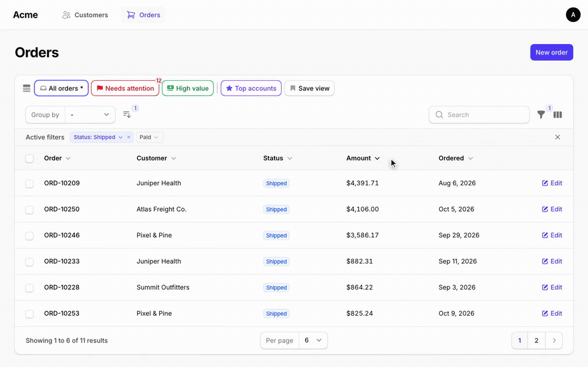

# TableKit

Saved views and power tools for Filament tables.

[](art/tablekit-demo.mp4)

[Watch the full demo (77 s)](art/tablekit-demo.mp4)

TableKit (`tablekit/filament-tablekit`) lets your users save the state of a table as a named view and open it again in one click. A bar above the table shows their favorite views. You can also ship ready-made views of your own.

You are reading the docs for **Filament 5**. See [Which version?](#which-version) for the other branches.

## What you get

- **Saved views**: save filters, search, column searches, sort, visible columns, column order and grouping under a name.
- **Preset views**: views you define in code, with an optional hidden query, a badge and a tooltip.
- **View manager**: a list to open, favorite, reorder, edit, delete and mark views as default.
- **Default view**: each user can pick one start view per table, and you can set a default in code.
- **Multi-sort**: sort by several columns, with a priority for each.
- **Quick filters**: clickable filter chips, with favorite filters that stay visible.
- **Column order**: the order from Filament's column manager is saved in views.
- **Color and icon pickers**: about 120 icons and 24 colors for your views.
- **RTL and translations**: English and Arabic included.
- **Multi-tenancy**: views are scoped by user, table and tenant.

## Which version?

Use the TableKit version that matches your Filament version. Composer picks it for you from the Filament you have installed.

| Filament | Livewire | TableKit | Branch | Laravel |
| --- | --- | --- | --- | --- |
| 5 | 4 | `^5.0` | `main` | 11.28+, 12, 13 |
| 4 | 3 | `^4.0` | `filament-v4` | 11.28+, 12, 13 |
| 3 | 3 | `^3.0` | `filament-v3` | 11.28+, 12 |

All versions need PHP 8.2 or newer.
Filament 5.0.0, 5.5.0, 5.7.0 and 5.8.0 fail the package tests before they reach plugin code, so they are excluded. The package is tested with Filament 5.10.1 and Livewire 4.4.7.

## Installation

You need an existing Filament 5 panel.

1. Install the package.

   ```bash
   composer require tablekit/filament-tablekit
   ```

   Not on Packagist yet, or want a branch? See [Install from GitHub](docs/installation.md#install-from-github).

2. Run the migrations. They load by themselves. If your app owns its migrations, see [Database](docs/database.md#publish-the-migrations).

   ```bash
   php artisan migrate
   ```

3. Add the trait to a list page, a relation manager or a table widget, for example `app/Filament/Resources/Orders/Pages/ListOrders.php`.

   ```php
   use TableKit\Concerns\HasTableKit;

   class ListOrders extends ListRecords
   {
       use HasTableKit;
   }
   ```

   Open the table. The bar with **Default** and **Save view** is now above it. No theme or CSS step is needed.

4. Optional: register the plugin in your panel provider (`app/Providers/Filament/AdminPanelProvider.php`, inside `panel()`). You only need it to change options. Everything works without it.

   ```php
   use TableKit\TableKitPlugin;

   $panel->plugin(TableKitPlugin::make());
   ```

## Your first preset

Return presets from the same class. Make the method `protected`. This one assumes a `status` filter and a sortable `ordered_at` column. A filter or column that does not exist is ignored.

```php
use TableKit\Presets\PresetTableView;

protected function getPresetTableViews(): array
{
    return [
        'shipped' => PresetTableView::make()
            ->label('Shipped')
            ->icon('truck')
            ->color('success')
            ->favorite()
            ->defaultFilters(['status' => ['value' => 'shipped']])
            ->defaultSort('ordered_at', 'desc'),
    ];
}
```

## Documentation

| Page | What is in it |
| --- | --- |
| [Installation](docs/installation.md) | Composer, GitHub, publish tags |
| [Configuration](docs/configuration.md) | Every config key and plugin option |
| [Views](docs/views.md) | Saved views, the bar, the manager, defaults, reload and the URL |
| [Presets](docs/presets.md) | Every preset method, with examples |
| [Multi-sort](docs/multi-sort.md) | Sort by several columns |
| [Quick filters](docs/quick-filters.md) | Filter chips and favorite filters |
| [Columns](docs/columns.md) | Column order in views and presets |
| [Colors and icons](docs/colors-and-icons.md) | Pickers, icon aliases, Tabler remap, translations |
| [Database](docs/database.md) | Tables, connection, tenancy, user keys, stored state |
| [Limits](docs/limits.md) | Known limits |
| [Testing](docs/testing.md) | Livewire test examples |
| [Upgrading](docs/upgrading.md) | Upgrade notes |

## Security and privacy

- A preset's hidden query is a filter, **not access control**. Users can drop it at any time. Put real rules in your resource query, policies or global scopes.
- A view stores the search text and filter values the user typed. This can be personal data. Views are **not** deleted with the user, so delete them when you delete the account. See [Database](docs/database.md#delete-a-users-views).
- The server checks ownership on every action. View ids and preset keys that come from the browser are checked again on the server.
- Views are scoped by user type, user id, tenant and table. Users never see each other's views.

## License

MIT. See [LICENSE](LICENSE).
